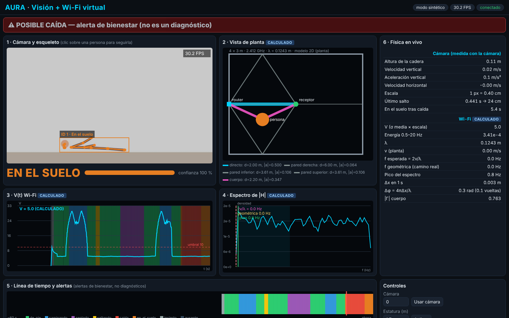
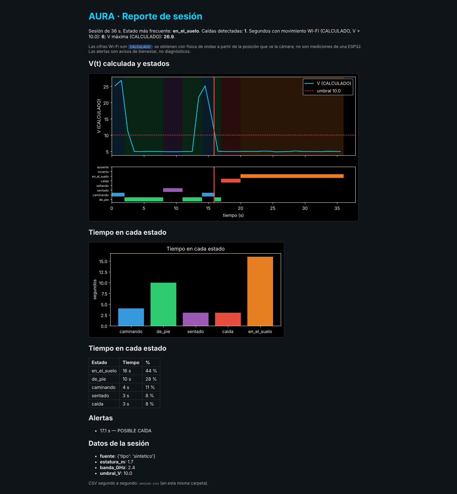
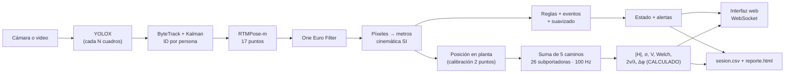

# AURA Vision · Visión + Wi-Fi virtual

[](https://github.com/hideki-ft/aura-vision/actions/workflows/pruebas.yml)
[](https://codespaces.new/hideki-ft/aura-vision)
[](LICENSE)

## 🌐 Pruébalo ahora en el navegador

### **👉 https://hideki-ft.github.io/aura-vision/**

Abre el enlace (en la laptop o en el celular), pulsa **"Empezar con mi cámara"** y acepta el permiso. No hay que
instalar nada. **Todo corre en tu dispositivo**: los modelos de pose se ejecutan en el navegador con ONNX Runtime
Web (GPU con WebGPU si está disponible, o CPU con WebAssembly), y **las imágenes de la cámara nunca salen del
navegador**, porque no hay servidor. También puedes "Usar un video de mi dispositivo" o "Probar sin cámara"
(persona sintética).

Para el público en clase: proyecta el **QR de esta página** (botón en Controles) y cada persona lo prueba en su
propio celular, con su cámara. No necesita estar en la misma red Wi-Fi que tu laptop.

| | Versión web (enlace) | App de escritorio (`python app.py`) |
|---|---|---|
| Instalación | Ninguna | Python + paquetes |
| Dónde corre | Navegador de cada visitante | Tu laptop (servidor local) |
| Pose | YOLOX-tiny + RTMPose-s/m (mismos modelos, mismo pre/posproceso) | Igual |
| Reglas, One Euro, Wi-Fi virtual | Traducción a JavaScript, verificada contra Python (`web/tests`) | Python |
| Seguimiento | Simplificado (IoU + cercanía) | ByteTrack con Kalman |
| Velocidad | Depende del dispositivo: con GPU (WebGPU) fluido; solo CPU, más lento | ≥ 15 FPS en CPU |
| Grabar sesión | Descarga `sesion.csv` + reporte HTML | Carpeta `sesiones/` |
| Extras | — | ST-GCN++ opcional, QR para ver la laptop desde el celular |

La primera visita descarga los modelos (~40 MB con calidad "Rápida", ~75 MB con "Precisa"). Usa Wi-Fi, no datos
móviles.

## ▶️ Ejecutar la app de escritorio desde GitHub

**En tu laptop (para la demostración con el público), Windows:**

1. En esta página: botón verde **Code → Download ZIP** y descomprímelo (o `git clone`).
2. Doble clic en **`instalar.bat`** (solo la primera vez; necesita internet: crea el entorno e instala paquetes y modelos).
   Si no tienes Python, el script te dice dónde bajarlo (3.11, marca *"Add python.exe to PATH"*).
3. Doble clic en **`iniciar.bat`** → se abre la app en el navegador con la cámara.
   Sin cámara o para ir sobre seguro: **`iniciar_demo.bat`** (usa `demo.mp4` si lo pones en la carpeta, o la
   persona sintética).

**El público, desde su celular:** escanea el **código QR** que muestra la app (botón "QR para el celular") y ve
en vivo los paneles en su teléfono. Requisito: estar en **la misma red Wi-Fi** que la laptop.
Si la red de la universidad aísla los dispositivos (pasa a menudo), activa en la laptop la **zona con cobertura
inalámbrica móvil** (Configuración → Red e Internet) y que el público se conecte a ella. La primera vez permite
Python en el **Firewall de Windows** (redes privadas). El enlace lleva un token: solo entra quien tiene el QR.

**Sin instalar nada (en la nube), GitHub Codespaces:** botón *Abrir en GitHub Codespaces* de arriba →
en la terminal: `python app.py --sintetico --no-navegador` → abre el puerto 8000 que ofrece Codespaces y añade
`?t=<token>` (lo imprime la terminal). En la nube **no hay cámara**: sirve para enseñar la interfaz y el Wi-Fi
virtual con la persona sintética o un video (`--demo`).

Linux/macOS: `./instalar.sh` y luego `./iniciar.sh` (acepta `--demo video.mp4`, `--sintetico`, ...).

Aplicación de escritorio en Python para una **demostración en vivo**. Una cámara reconoce en tiempo real qué
hace una persona (de pie, sentada, caminando, saltando, en el suelo, posible caída). A la vez, un panel de
**Wi-Fi virtual** calcula con física de ondas lo que mediría un sensor Wi-Fi (ESP32) a partir de la posición
del cuerpo.

> **Por ahora no hay ESP32: la cámara la reemplaza.** Todo lo del panel Wi-Fi lleva la etiqueta
> **CALCULADO**. Solo los datos reales de la maqueta que cargues desde un CSV llevan **MEDIDO (maqueta)**.



*Captura en modo sintético: una figura de palitos, sin personas reales. La rutina incluye una caída simulada,
que dispara la alerta de bienestar.*

---

## Índice

1. [Qué hace](#1-qué-hace)
2. [Instalación paso a paso en Windows](#2-instalación-paso-a-paso-en-windows)
3. [Cómo usarla](#3-cómo-usarla)
4. [Lista para el día de la presentación](#4-lista-para-el-día-de-la-presentación)
5. [Cómo funciona, explicado desde cero](#5-cómo-funciona-explicado-desde-cero)
6. [Resumen de fórmulas](#6-resumen-de-fórmulas)
7. [Qué es CALCULADO y qué es MEDIDO](#7-qué-es-calculado-y-qué-es-medido)
8. [Grabar sesiones, reporte y CSV](#8-grabar-sesiones-reporte-y-csv)
9. [Configuración (config.yaml)](#9-configuración-configyaml)
10. [Opcional: ST-GCN++ (NTU RGB+D 120)](#10-opcional-st-gcn-ntu-rgbd-120)
11. [Código, pruebas y rendimiento](#11-código-pruebas-y-rendimiento)
12. [Limitaciones](#12-limitaciones)
13. [Ética y privacidad](#13-ética-y-privacidad)
14. [Qué sigue: la ESP32 real](#14-qué-sigue-la-esp32-real)
15. [Licencia](#15-licencia)

---

## 1. Qué hace

| Parte | Qué hace | ¿Entrena algo? |
|---|---|---|
| Visión | Encuentra a cada persona y 17 puntos de su cuerpo (RTMPose-m + detector YOLOX, con rtmlib y ONNX Runtime) | No: modelos ya entrenados |
| Seguimiento | Da un **ID** a cada persona (ByteTrack ligero con filtro de Kalman). Con un clic eliges a quién seguir | No |
| Suavizado | **One Euro Filter** sobre los 17 puntos (quita el temblor sin añadir retraso) | No |
| Reglas físicas | Convierte píxeles a metros con tu estatura y decide el estado: `de_pie`, `sentado`, `caminando`, `saltando`, `en_el_suelo`, `caida`, `ausente`, `incierto` | No |
| Wi-Fi virtual | Suma de 5 caminos de onda (método de imágenes), 26 subportadoras a 100 muestras/s → \|H\|, σ, **V**, espectro y energía | No |
| Interfaz | Página web local (FastAPI + WebSocket) con 6 paneles y QR para abrirla desde el celular | — |
| Sesiones | CSV segundo a segundo (etiquetas para la futura ESP32) y reporte HTML | — |

Funciona en **CPU**, sin GPU. Si tienes una GPU NVIDIA, la usa automáticamente.

---

## 2. Instalación paso a paso en Windows

**Requisitos:** Windows 10/11, una cámara (la integrada sirve) e internet **solo la primera vez**, para bajar
los paquetes y los modelos (~70 MB).

> Atajo: los pasos 4 a 6 los hace solos **`instalar.bat`** (doble clic), y el 7 **`iniciar.bat`**.

1. **Instala Python 3.11** desde <https://www.python.org/downloads/>. En la primera pantalla del instalador
   marca **"Add python.exe to PATH"**.
2. **Descarga este proyecto:** botón verde *Code → Download ZIP* en GitHub y descomprímelo. Si sabes usar Git,
   también puedes hacer `git clone`.
3. **Abre una terminal en la carpeta del proyecto:** en el Explorador, entra en la carpeta, escribe `cmd` en
   la barra de direcciones y pulsa Enter.
4. **Crea un entorno virtual** (una "caja" aislada para los paquetes) y actívalo:

   ```bash
   py -3.11 -m venv .venv
   ```

   ```bash
   .venv\Scripts\activate
   ```

   Si usas PowerShell y te da un error de permisos, usa `cmd` o ejecuta antes
   `Set-ExecutionPolicy -Scope CurrentUser RemoteSigned`.
5. **Instala los paquetes:**

   ```bash
   pip install -r requirements.txt
   ```

6. **Verifica el entorno y descarga los modelos.** Revisa Python, paquetes, modelos, cámara, red y la
   velocidad estimada:

   ```bash
   python verificar_entorno.py --descargar-modelos
   ```

7. **Inicia la aplicación:**

   ```bash
   python app.py
   ```

   La página se abre sola en el navegador. La terminal muestra la dirección y un **código QR** para el
   celular. La primera vez, Windows preguntará por el **Firewall**: permite el acceso en **redes privadas**,
   o el celular no podrá conectarse.

Si la cámara no se abre: cierra Zoom/Teams y revisa *Configuración → Privacidad → Cámara → permitir a las apps
de escritorio*. También puedes probar `python app.py --camara 1`.

En Linux o macOS: `python3 -m venv .venv`, luego `source .venv/bin/activate`, y los mismos pasos 5 a 7.

---

## 3. Cómo usarla

```bash
python app.py                      # cámara 0
```

```bash
python app.py --demo mi_video.mp4  # MODO DEMO: un video pregrabado en vez de la cámara
```

```bash
python app.py --sintetico          # sin cámara ni modelos: una persona sintética (respaldo extremo)
```

```bash
python app.py --modo lightweight   # si la laptop va lenta (balanced es el modo por defecto)
```

Otras opciones: `--estatura 1.62`, `--puerto 8001`, `--solo-local` (sin acceso desde el celular),
`--no-navegador`.

### Los 6 paneles

1. **Cámara y esqueleto:** el esqueleto toma el color del estado, con el ID y una etiqueta grande, una barra de
   confianza y los FPS. **Haz clic sobre una persona** para seguirla.
2. **Vista de planta** (CALCULADO): la habitación de 4 × 3 m con el router, el receptor, la persona y los
   **5 caminos** de la onda. El grosor de cada trazo es proporcional a su amplitud, y el camino directo sale
   punteado si el cuerpo lo bloquea.
3. **V(t)** (CALCULADO): la línea roja es el umbral (10) y el fondo se colorea según el estado. Si cargaste un
   CSV real, también aparece la curva **MEDIDO (maqueta)**.
4. **Espectro** (CALCULADO): espectro de |H| con la frecuencia esperada **2v/λ** marcada, la frecuencia
   geométrica real y el pico.
5. **Línea de tiempo y alertas:** los estados del último minuto y las alertas («POSIBLE CAÍDA», «sigue en el
   suelo tras 30 s»…).
6. **Física en vivo:** altura y velocidades de la cadera, último salto, V, λ, frecuencia esperada frente al
   pico, Δx, Δφ y |Γ|.

### Controles

- **Cámara:** cambia el índice de la cámara.
- **Estatura:** la estatura de la persona, en metros. Es necesaria para convertir a metros.
- **Banda:** 2.4 GHz (λ ≈ 0.125 m) o 5.18 GHz (λ = 0.0579 m).
- **Umbrales:** V, velocidad de caída y velocidad para considerar que camina.
- **Contraste del cuerpo:** deslizador de |Γ|. Con 0, la persona se vuelve **invisible** para el Wi-Fi.
- **Calibrar piso (2 clics):** marca en el video los puntos A y B del piso por donde camina la persona.
- **Calibrar V:** con la persona quieta, ajusta la escala para que V ≈ 5.
- **Cargar CSV real:** carga datos de la maqueta.
- **Grabar sesión:** al detenerla se abre el reporte.
- **Modo privacidad:** deja de enviar la imagen; solo se ve el esqueleto sobre negro.
- **QR para el celular.**

### Abrirla en el celular

El celular debe estar en **la misma red Wi-Fi** que la laptop. Escanea el QR que aparece en la terminal o en
el botón "QR para el celular". La dirección lleva un **token** aleatorio (`?t=...`): sin él, nadie más de la
red puede ver la cámara.

---

## 4. Lista para el día de la presentación

- [ ] Con internet, el día anterior: `python verificar_entorno.py --descargar-modelos`. Así los modelos quedan
      guardados y la app funciona sin internet.
- [ ] Graba un **video de respaldo** lateral con `python herramientas/grabar_video_demo.py --salida demo.mp4`
      y pruébalo con `python app.py --demo demo.mp4`.
- [ ] Ten a mano el respaldo extremo, `python app.py --sintetico`, que no necesita ni cámara ni modelos.
- [ ] Laptop **enchufada** y en modo "Máximo rendimiento". Cierra Zoom, Teams y el navegador con muchas
      pestañas.
- [ ] Si los FPS bajan de ~12: `python app.py --modo lightweight`.
- [ ] Cámara **de lado**, fija, a 3-5 m, con el cuerpo completo en la imagen, buena luz y nada de ventanas
      detrás.
- [ ] Escribe la **estatura** de quien hace la demo.
- [ ] Caídas **simuladas sobre un colchón**, con supervisión. Nadie se cae de verdad.
- [ ] Consentimiento firmado de quien aparezca en cámara (ver [Ética](#13-ética-y-privacidad)).
- [ ] Para que el Wi-Fi virtual **también reaccione a la caída**, activa el modelo 3D:
      `wifi.altura_antenas_m: 1.0` en config.yaml (ver [5.9](#59-wi-fi-virtual-suma-de-caminos)).

---

## 5. Cómo funciona, explicado desde cero

### 5.1 La imagen

Una imagen es una tabla de **píxeles**. Cada píxel tiene una posición (x hacia la derecha, y **hacia abajo**)
y un color. La cámara entrega unas 30 imágenes ("cuadros") por segundo. Todo lo que sigue se hace para cada
cuadro.

### 5.2 Estimación de pose (sin entrenar nada)

Usamos dos **redes neuronales ya entrenadas** por OpenMMLab, en formato ONNX. Solo las usamos ("inferencia");
no las entrenamos.

1. **Detector de personas (YOLOX):** devuelve una caja alrededor de cada persona.
2. **RTMPose-m:** recibe el recorte de cada caja y devuelve **17 puntos clave** (nariz, ojos, orejas, hombros,
   codos, muñecas, caderas, rodillas y tobillos), cada uno con una **confianza** de 0 a 1. Para cada
   coordenada predice una distribución sobre posiciones posibles (técnica *SimCC*) y se queda con la más
   probable.

La librería **rtmlib** ejecuta estos modelos con **ONNX Runtime**, sin PyTorch ni mmcv. Para ir rápido en
CPU, el detector **no corre en cada cuadro** (cada 3 en el modo balanced). En los demás cuadros, la caja de
cada persona se calcula a partir de su esqueleto anterior. Además, todas las personas se procesan **en un solo
lote**.

| Modo | Detector | Pose | Detecta cada | Personas con esqueleto |
|---|---|---|---|---|
| `lightweight` | YOLOX-tiny | RTMPose-s | 6 cuadros | 1 |
| `balanced` (defecto) | YOLOX-tiny | **RTMPose-m** | 3 cuadros | 2 (la objetivo, en cada cuadro) |
| `performance` | YOLOX-m | RTMPose-m | 2 cuadros | 4 (pensado para GPU) |

### 5.3 Seguimiento: un ID por persona

El detector no sabe que la persona de este cuadro es la misma del anterior. El **seguidor** sí lo sabe:

- **Filtro de Kalman:** para cada persona guarda la caja y su velocidad, y **predice** dónde estará en el
  siguiente cuadro (modelo de velocidad constante), junto con su incertidumbre.
- **Asociación:** compara cada caja predicha con cada caja detectada mediante el
  **IoU = área de la intersección / área de la unión**, y el **algoritmo húngaro** las empareja de la mejor
  forma.
- **ByteTrack** hace la asociación en dos pasadas: primero las detecciones seguras, luego las débiles (una
  persona medio tapada).
- Añadimos una **tercera pasada por cercanía del centro**. Al caer, la caja pasa de vertical a horizontal en
  menos de medio segundo y el IoU baja, pero la persona es la misma. Además, si el ID objetivo desaparece y
  aparece otro justo en su lugar, la app lo trata como la misma persona.

### 5.4 One Euro Filter (suavizado)

Los puntos clave "tiemblan" uno o dos píxeles entre cuadros. Un promedio simple los suavizaría, pero añadiría
retraso. El **One Euro Filter** es un filtro pasa-bajos que se adapta a la velocidad del movimiento:

```
τ = 1 / (2π·fc)        α = 1 / (1 + τ/Te)        (Te = tiempo entre cuadros)
dx̂ = filtro(α(d_cutoff), (x − x̂_anterior)/Te)     (velocidad suavizada)
fc = min_cutoff + β·|dx̂|                           (más velocidad → corte más alto → menos retraso)
x̂ = α(fc)·x + (1 − α(fc))·x̂_anterior
```

Con la persona quieta, el corte es bajo y elimina el temblor. Con la persona rápida, el corte sube y casi no
hay retraso. Los parámetros están en `config.yaml → one_euro`.

### 5.5 De píxeles a metros

- **Estatura aparente H (px):** la suma pierna + muslo + tronco (tobillo→rodilla→cadera→hombro) es el 77.9 %
  de la estatura (tablas antropométricas de Winter) y casi no cambia con la postura. Por eso
  `H = (pierna + muslo + tronco) / 0.779`. Se usa el percentil 75 de los últimos 10 s.
- **Escala:** `1 px = estatura_m / H` metros.
- **Suelo:** la posición del tobillo más bajo cuando la persona está erguida, más la altura del tobillo
  (3.9 % de la estatura).
- **Altura de la cadera:** `h = (y_suelo − y_cadera) / H` alturas de persona. Vale ≈ 0.53 de pie, ≈ 0.28
  sentada y ≈ 0.06 en el suelo. En metros: `h · estatura`.

### 5.6 Cinemática (velocidad y aceleración, en SI)

Con las alturas de la cadera de los últimos 0.3 s se ajusta una **parábola** `h(t) = a·t² + b·t + c` por
mínimos cuadrados. En el instante actual:

- **velocidad vertical** `v_y = b` (m/s);
- **aceleración vertical** `a_y = 2a` (m/s²). En una caída libre, `a_y ≈ −9.8 m/s²`.

La **velocidad horizontal** es la pendiente de una recta ajustada a la posición horizontal de la cadera, en
metros. Todo es **causal**: solo usa el pasado, porque estamos en vivo.

### 5.7 Reglas físicas (lógica difusa)

En vez de umbrales rígidos ("cadera > 0.4"), cada condición es una **rampa** que va de 0 a 1:
`rampa(x, a, b)` vale 0 en `a`, 1 en `b`, y es lineal entre ambos. Cada postura recibe un **puntaje**:

```
erguido     = rampa(h, 0.36, 0.44) · rampa(θ, 40°, 25°)          θ = ángulo del torso con la vertical
de_pie      = erguido · rampa(|vx|, 0.25, 0.12)                   |vx| en alturas/s
caminando   = erguido · rampa(|vx|, 0.12, 0.25)                   (0.25 H/s ≈ 0.43 m/s)
sentado     = rampa(h, 0.12, 0.20) · rampa(h, 0.44, 0.36) · rampa(θ, 55°, 35°) · (0.5 + 0.5·rampa(κ, 155°, 120°))
en_el_suelo = max( rampa(h, 0.20, 0.12),  rampa(h, 0.32, 0.22) · max(rampa(θ, 45°, 65°), rampa(alto/ancho, 1.2, 0.8)) )
```

(κ = ángulo de la rodilla; 180° es la pierna recta.)

- **Confianza:** `s1 · √(clip((s1 − s2)/0.3, 0, 1)) · (0.5 + 0.5·rampa(conf_puntos, 0.35, 0.70))`, donde s1 y
  s2 son el mejor y el segundo mejor puntaje.
- **`incierto`:** el mejor puntaje es < 0.40, dos reglas casi empatan (diferencia < 0.15), la confianza de los
  puntos es baja o no se ven las piernas.
- **`ausente`:** no se ve a la persona durante más de 0.5 s.
- **`caida` (evento):** la cadera cruza hacia abajo 0.20 H. La app retrocede hasta el inicio del descenso y
  exige tres cosas: duración < 1 s, bajada ≥ 0.25 H (~42 cm) y velocidad pico ≥ 0.9 H/s (~1.5 m/s). Luego
  confirma que en el segundo siguiente la persona sigue en el suelo (≥ 60 % de los cuadros). Por eso la
  etiqueta aparece **~1 s después** de la caída. Tumbarse despacio **no** es una caída.
- **`saltando` (evento):** la cadera sube más de 0.05 H sobre su nivel de pie, con velocidad de subida ≥ 0.6
  H/s, y los tobillos dejan el suelo. La **altura del salto** sale del tiempo de vuelo `t`: en un tiro
  vertical, `h = g·t²/8`. Como solo vemos el vuelo cuando el tobillo supera un umbral δ, se corrige con
  `t = √(t_δ² + 8δ/g)`.
- **Suavizado temporal:** la etiqueta más votada de los últimos 0.4 s, y un estado nuevo debe mantenerse una
  **duración mínima** (0.4-0.6 s) antes de mostrarse. Esto evita parpadeos.

### 5.8 Alertas de bienestar

Tras una caída confirmada, la app cuenta el **tiempo en el suelo** hasta que la persona vuelve a estar
sentada o de pie. Las alertas son escalonadas y configurables: «POSIBLE CAÍDA», «sigue en el suelo tras
30 s» y «sigue en el suelo tras 2 min». Son **avisos de bienestar** para que alguien vaya a ver cómo está la
persona. **No son diagnósticos**, y **la app nunca llama a emergencias**.

### 5.9 Wi-Fi virtual: suma de caminos

**Ondas.** El Wi-Fi es una onda electromagnética de frecuencia `f`, y su longitud de onda es `λ = c / f`.
A 2.4 GHz, λ ≈ 0.125 m (canal 1: 2.412 GHz → 0.1243 m); a 5.18 GHz, λ = 0.0579 m. Al recorrer una distancia
`d`, la onda acumula una **fase** de `2π·d/λ`.

**Varios caminos.** La onda va del router (T) al receptor (R) por varios caminos a la vez, y en el receptor se
**suman** como números complejos (cada uno con su amplitud y su fase):

```
H = Σ_n a_n · e^(−j·2π·d_n/λ)
```

Los 5 caminos del modelo (igual que en el informe de Física II):

| Camino | Longitud d | Amplitud a |
|---|---|---|
| Directo T→R | \|T−R\| = 2 m | `1/d`; si el cuerpo lo cruza se multiplica por `transmision_bloqueo` (0.35) |
| 3 paredes (método de imágenes) | \|T'−R\|, con T' = T reflejado en la pared | `Γ_pared/d`, Γ_pared = −0.382 |
| Cuerpo T→persona→R | \|T−P\| + \|P−R\| | `Γ_cuerpo/d`, Γ_cuerpo = −0.763 |

- **Método de imágenes:** una reflexión en una pared plana equivale a una onda que sale de una "imagen" del
  router al otro lado de la pared, como en un espejo. La pared donde está el router no aporta un camino
  propio; por eso son 3.
- **Coeficiente de Fresnel:** a incidencia normal, `Γ = (1 − √εr) / (1 + √εr)`. Para el concreto (εr ≈ 5) da
  Γ = −0.382; para la piel o el cuerpo (εr ≈ 55) da Γ = −0.763. El **signo negativo** es la **inversión de
  fase de 180°** al reflejarse en un medio más denso.
- **Subportadoras:** el Wi-Fi usa varias frecuencias a la vez. Calculamos **26 subportadoras** separadas
  312.5 kHz alrededor de la frecuencia central, igual que el CSI de una ESP32.
- **100 muestras/s:** la cámara da ~15-30 posiciones por segundo. Entre dos cuadros, la posición se
  **interpola** linealmente y H se calcula 100 veces por segundo. Después se suma **ruido** gaussiano complejo
  (`ruido_sigma`).
- **Posición en la planta:** la cámara solo ve la posición horizontal de la cadera. Con la **calibración de 2
  puntos** (marcas A y B en el piso, cuyas coordenadas reales están en config.yaml), la persona se ubica sobre
  la recta A-B: `s = (P − A_px)·(B_px − A_px) / |B_px − A_px|²` y `posición = A_m + s·(B_m − A_m)`. Sin
  calibrar, se usa la escala de la estatura.
- **Modelo 2D o 3D:** el modelo del informe es 2D, en planta. En 2D, una **caída** (movimiento vertical) casi
  no cambia V: en las pruebas, V se queda en ~5. Con `wifi.altura_antenas_m: 1.0`, el camino del cuerpo usa la
  altura del tronco y la caída produce un pico de V (~36 en las pruebas). Es opcional y está desactivado por
  defecto para ser fiel al informe.

### 5.10 Las métricas de la maqueta (CALCULADAS)

- **|H_k|:** amplitud de la subportadora k.
- **σ_k:** desviación estándar de |H_k| en ventanas de **1 s** (100 muestras), es decir, cuánto "tiembla" cada
  subportadora.
- **V = escala · promedio_k(σ_k).** La escala por defecto es `5 / ruido_sigma`, para que **V ≈ 5 con la
  persona quieta**. El botón "Calibrar V" la ajusta con la persona quieta delante de la cámara.
- **Movimiento Wi-Fi (calculado)** si **V > 10**.
- **Espectro (Welch):** el método divide la señal en trozos, calcula su transformada de Fourier y promedia.
  Se aplica a cada |H_k| (sin su media) y se promedia sobre k. La **energía en 0.5-20 Hz** es el área bajo el
  espectro en esa banda.

### 5.11 La física en vivo

- **Frecuencia esperada `f = 2v/λ`.** Si la persona se aleja Δx del router y del receptor (que están juntos),
  el camino reflejado crece **2·Δx** (ida y vuelta). La fase cambia entonces `2π·2Δx/λ = 4πΔx/λ`, y el |H|
  oscila con frecuencia `f = 2v/λ`. Ejemplo: a 1 m/s y 2.4 GHz, f ≈ 16 Hz.
- **Frecuencia geométrica.** Con el router y el receptor separados, la frecuencia real es
  `f = |d(d_cuerpo)/dt| / λ`, que es **≤ 2v/λ**. Cuando la persona cruza la línea router-receptor por el
  medio, d_cuerpo casi no cambia y f ≈ 0. El panel muestra las dos frecuencias y el pico del espectro.
- **Giro de fase:** `Δφ = 4π·Δx/λ` para el desplazamiento del último segundo. Una vuelta completa (2π) son
  λ/2 de desplazamiento.
- **Contraste del cuerpo:** si |Γ| → 0, el cuerpo no refleja ni bloquea, así que la persona es **invisible**
  para el Wi-Fi: V vuelve a ~5 aunque camine. Puedes demostrarlo en vivo con el deslizador.

---

## 6. Resumen de fórmulas

| Qué | Fórmula |
|---|---|
| Longitud de onda | λ = c / f |
| Estatura aparente | H = (pierna + muslo + tronco) / 0.779 |
| Escala | m/px = estatura / H |
| Altura de la cadera | h = (y_suelo − y_cadera) / H (× estatura → m) |
| Velocidad y aceleración | ajuste h(t) = a t² + b t + c → v = b, a_y = 2a |
| One Euro | fc = min_cutoff + β·\|dx̂\| ; α = 1/(1 + 1/(2π fc Te)) |
| Rampa difusa | rampa(x, a, b) = clip((x − a)/(b − a), 0, 1) |
| Altura de salto | h = g·t²/8, con t = √(t_δ² + 8δ/g) |
| Canal | H = Σ a_n · e^(−j·2π·d_n/λ) |
| Fresnel (incidencia normal) | Γ = (1 − √εr)/(1 + √εr) → concreto −0.382, cuerpo −0.763 |
| Subportadoras | f_k = f_c + (k − 12.5)·312.5 kHz, k = 0…25 |
| Variabilidad | V = escala · media_k(σ_k), σ_k en ventanas de 1 s |
| Frecuencia esperada | f = 2v/λ |
| Giro de fase | Δφ = 4π·Δx/λ |

---

## 7. Qué es CALCULADO y qué es MEDIDO

| Dato | Origen | Etiqueta |
|---|---|---|
| Esqueleto, estado, alturas y velocidades de la cadera | La cámara (medido con visión, con la escala de la estatura) | Panel "Cámara" |
| \|H\|, σ_k, V, espectro, energía, caminos, f, Δφ | **Calculado** con física a partir de la posición que da la cámara | **CALCULADO** |
| Curva V(t) de un CSV de la maqueta | **Medido** con la ESP32 real (grabaciones previas) | **MEDIDO (maqueta)** |

Formato del CSV real (la primera fila son los nombres de las columnas):

- `tiempo,V`: se usa V tal cual.
- `tiempo,sc0,sc1,…,sc25`: amplitudes por subportadora. V se calcula igual que en la maqueta, con la escala
  `wifi.escala_V_medido`.
- La columna de tiempo puede llamarse `tiempo`, `t`, `time`, `tiempo_s` o `timestamp`. Si está en
  milisegundos, se convierte sola.

La curva medida se reproduce en bucle al lado de la calculada, desde el momento en que la cargas.

---

## 8. Grabar sesiones, reporte y CSV

Pulsa **● Grabar sesión** y, al terminar, **■ Detener y generar reporte**. Si cierras la app con Ctrl+C, el
reporte también se genera. Todo queda en `sesiones/AAAAMMDD_HHMMSS/`:

- `sesion.csv`: **una fila por segundo**, con estas columnas:
  `segundo, tiempo_s, estado, confianza_media, vel_horizontal_ms, vel_vertical_ms, altura_cadera_m, pos_x_m, pos_y_m, V_calculado, energia_0p5_20Hz_calculado, movimiento_wifi_calculado, alerta`.
  Servirá como **etiquetas** cuando se use una ESP32 real.
- `reporte.html`: gráficas de V(t) con los estados, el tiempo en cada estado, el número de caídas, las alertas
  y un resumen.



---

## 9. Configuración (config.yaml)

Todo está comentado en el propio archivo. Las secciones:

- `fuente`: cámara, resolución y video demo.
- `pose`: modo, dispositivo y umbrales.
- `seguimiento`: el tracker.
- `one_euro`: el suavizado.
- `persona`: la estatura.
- `clasificacion`: todas las rampas, eventos y duraciones mínimas.
- `alertas`: los segundos y mensajes de cada alerta.
- `wifi`: habitación, router, receptor, banda, Γ, ruido, escala, umbral y ventanas.
- `calibracion`: puntos A y B del piso.
- `gcn`: el clasificador opcional.
- `interfaz`: puerto, privacidad, calidad del video.

Puedes tener un archivo propio solo con los cambios y usarlo con `python app.py --config mi_config.yaml`.

---

## 10. Opcional: ST-GCN++ (NTU RGB+D 120)

**ST-GCN++** es una red de grafos espacio-temporales. Mira una secuencia de esqueletos (100 cuadros × 17
puntos) y predice una de las 120 acciones del dataset **NTU RGB+D 120**, por ejemplo *sentarse* (A8),
*levantarse* (A9), *saltar* (A27), *tambalearse* (A42) o *caerse* (A43). En AURA se usa **solo como segunda
opinión** en el panel de física: no cambia las reglas. Está **desactivada por defecto**.

Pasos (en un ordenador con Linux o en Colab, porque solo hay que hacerlos una vez):

1. Instala **MMAction2** (OpenMMLab, Apache-2.0) siguiendo su documentación.
2. Descarga de su *model zoo* el checkpoint de ST-GCN++ entrenado en **NTU120-XSub con keypoints 2D** (formato
   COCO de 17 puntos).
3. Expórtalo a ONNX con el script de despliegue de MMAction2 para GCN (`tools/deployment/export_onnx_gcn.py`).
   Comprueba los argumentos exactos en la documentación de tu versión. La entrada debe tener forma
   `(1, M, T, 17, 3)`: M personas, T cuadros y (x, y, confianza).
4. Copia el `.onnx` a `modelos/stgcnpp_ntu120_2d.onnx` y pon `gcn.activado: true` en `config.yaml`.
   `gcn.cuadros` debe coincidir con la T del modelo (normalmente 100).

**Licencias:** el código de MMAction2 es Apache-2.0, pero **NTU RGB+D se distribuye para investigación no
comercial** (hay que solicitar acceso). Un modelo entrenado con esos datos hereda esas condiciones: úsalo solo
con fines académicos.

---

## 11. Código, pruebas y rendimiento

```
aura-vision-app/
├── app.py                  # inicio:  python app.py
├── instalar.bat / iniciar.bat / iniciar_demo.bat   # Windows con doble clic (instalar.sh / iniciar.sh en Linux/macOS)
├── verificar_entorno.py    # revisa Python, paquetes, modelos, cámara, red y velocidad
├── .github/workflows/      # pruebas automáticas en Windows y Linux (GitHub Actions)
├── .devcontainer/          # configuración de GitHub Codespaces
├── config.yaml             # todos los parámetros, comentados
├── aura/
│   ├── motor.py            # cámara/video → pose → seguimiento → suavizado → reglas → Wi-Fi
│   ├── sesion.py           # CSV por segundo + reporte HTML
│   ├── sintetico.py        # persona sintética (tests y --sintetico)
│   ├── vision/             # pose.py, seguimiento.py, one_euro.py, clasificador.py, calibracion.py, esqueleto.py, gcn.py
│   ├── wifi_virtual/       # canal.py (suma de caminos), simulador.py (100 Hz), metricas.py (V, Welch), medido.py (CSV real)
│   └── ui/                 # servidor.py (FastAPI + WebSocket) y static/ (HTML, CSS, JS)
├── web/                    # VERSIÓN WEB (GitHub Pages): index.html, js/ (motor, pose ONNX Runtime Web, reglas, Wi-Fi),
│                           #   modelos/ (ONNX), datos/ (config.json, rutina sintética), tests/ (equivalencia con Python)
├── herramientas/           # grabar_video_demo.py, descargar_video_prueba.py, exportar_web.py
├── tests/                  # pytest
└── docs/                   # capturas
```



### Pruebas

```bash
python -m pytest -q
```

```bash
node --test web/tests/equivalencia.test.mjs   # la versión web da lo mismo que la de Python
```

Si cambias `config.yaml` o `aura/ui/static/app.js`, regenera los datos de la versión web con
`python herramientas/exportar_web.py`. Un test avisa si se te olvida.

Las 43 pruebas no necesitan cámara ni modelos. Comprueban:

- las **reglas** con secuencias sintéticas: caída libre, caminata, salto, sentarse, tumbarse despacio, ausente,
  incierto y la cinemática en SI;
- el **One Euro Filter**;
- la **suma de caminos**: la habitación vacía tiene |H| constante, con |Γ| = 0 la persona no cambia H, el
  método de imágenes, el bloqueo y el modelo 3D;
- el cálculo de **V**, Welch y la energía;
- que **f = 2v/λ** aparece como pico del espectro;
- el seguimiento, incluido que el ID no cambia durante una caída;
- el servidor: token, WebSocket, comandos, CSV medido, grabación y reporte;
- el motor completo detectando la caída de la rutina sintética;
- el envoltorio de ST-GCN++.

### Rendimiento medido

Medido en una máquina virtual con Intel Xeon a 2.1 GHz, 4 núcleos y solo CPU. Una laptop moderna suele ser
más rápida.

| Modo | 1 persona | 2 personas |
|---|---|---|
| lightweight | ~34 FPS | ~29 FPS |
| balanced | ~18 FPS | ~16 FPS |
| performance | — | ~4 FPS (necesita GPU) |

En modo demo con video se suma el costo de decodificarlo (balanced: ~14-15 FPS en esa misma máquina).
`verificar_entorno.py` estima la velocidad en tu laptop.

---

## 12. Limitaciones

- **Vista lateral y cámara fija.** Las alturas y velocidades en metros suponen que la persona se mueve en un
  plano paralelo a la cámara. Si se acerca o se aleja, la escala cambia: con la cámara a 4 m, 0.5 m de
  diferencia supone ~12 % de error. Con cámaras cenitales o muy elevadas, las alturas no tienen sentido.
- **Cuerpo completo visible.** Sin piernas visibles, el estado es `incierto`.
- **Una persona objetivo.** Se dibujan varias, pero las reglas y el Wi-Fi usan solo la elegida. Si dos personas
  se cruzan, los IDs pueden intercambiarse.
- **Caídas.** Se confirman ~1 s después. Una caída desde una silla (bajada < 0.25 H) o detrás de un mueble
  puede no detectarse. Los umbrales son puntos de partida, no valores universales.
- **El Wi-Fi virtual es un modelo simplificado, no una medición.** Considera la planta 2D (3D opcional), un
  cuerpo puntual, amplitudes ∝ 1/d (como en el informe; un modelo de radar usaría 1/(d₁·d₂)), solo 5 caminos
  (sin dobles reflexiones), y no incluye antenas reales, el control automático de ganancia ni el ruido de fase
  de una ESP32. Sus valores ilustran la física; **no sustituyen a una medición**.
- **Rendimiento.** En laptops muy antiguas puede quedar por debajo de 15 FPS; usa `--modo lightweight`.

---

## 13. Ética y privacidad

- **Consentimiento (Ley N.º 29733, Perú).** La imagen de una persona es un dato personal. Antes de grabar o
  mostrar a alguien en la cámara, obtén su **consentimiento previo, informado, expreso e inequívoco**, de
  preferencia por escrito. Explícale **para qué** se usa (una demostración académica), que no se publicará y
  cuándo se borrará. Para menores de edad, el consentimiento lo dan sus padres o tutores. Respeta también el
  reglamento vigente de la ley.
- **Todo es local.** El video se procesa en la laptop y **no se envía a ningún servicio externo**. Solo se
  descargan los modelos la primera vez. El acceso desde el celular es solo dentro de la red local y requiere
  el token.
- **Modo privacidad:** la imagen no sale del motor; solo se ve el esqueleto sobre fondo negro.
- **Lo que se guarda:** las sesiones solo guardan **números** (estado, velocidades, V…), **nunca imágenes**.
  `.gitignore` excluye videos, sesiones y CSV para que no se suban por error a GitHub. Borra las sesiones
  cuando ya no las necesites.
- **Seguridad en la demo:** **nadie realiza caídas reales**. Se simulan sobre un **colchón**, con supervisión
  y sin movimientos bruscos de cabeza o cuello.
- **No es un dispositivo de salud.** Las alertas son **avisos de bienestar, no diagnósticos**. La app **nunca
  llama a emergencias** ni debe usarse para cuidar a nadie sin supervisión humana.
- **El objetivo es no necesitar cámaras.** La cámara solo se usa para etiquetar datos y validar la física; la
  meta final es un sensor Wi-Fi que no capta imágenes.

---

## 14. Qué sigue: la ESP32 real

1. Grabar el **CSI** de la ESP32, con sus 26 subportadoras, al mismo tiempo que AURA graba la sesión, con los
   relojes sincronizados (por ejemplo, con una palmada o un evento visible al inicio).
2. Usar `sesion.csv` como **etiquetas** segundo a segundo del CSI real.
3. Comparar V **MEDIDO** frente a **CALCULADO**: cargar el CSV de la maqueta en la app y ajustar `ruido_sigma`,
   Γ y la geometría del modelo.
4. Entrenar un clasificador con el CSI etiquetado, para que el Wi-Fi reconozca los estados sin cámara.

---

## 15. Licencia

**Apache License 2.0** (ver [LICENSE](LICENSE) y [NOTICE](NOTICE)). Dependencias: rtmlib, los modelos
RTMPose/YOLOX y OpenCV son Apache-2.0; ONNX Runtime y FastAPI, MIT; NumPy y SciPy, BSD. **No se usa
Ultralytics/YOLO** (AGPL-3.0).
